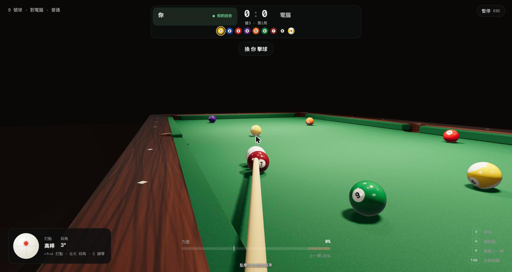

# 3D Pool

English | [繁體中文](README.zh-TW.md)

First-person 3D American pool that runs in the browser. Nothing to install.

**▶ Play now: https://yenchiachen.github.io/pool3d/**



## Features

- **8-ball and 9-ball** with basic fouls, ball in hand, and cue ball placement on the break
- **vs Computer** (three difficulty levels), **two players on one device**, **online**, and **practice**
- Side spin, follow, draw, jump and masse shots: both the tip position and the cue elevation affect the cue ball
- In 9-ball, the next ball to hit is marked (toggle with N)
- Plays on phones: touch aiming and a power bar, fullscreen on Android (on iOS, use "Add to Home Screen")
- English and Traditional Chinese UI. Switch in the top-right corner of the home screen, or add `?lang=en` / `?lang=zh` to the URL

## Controls

| Desktop | |
|---|---|
| Mouse | Aim / tilt view |
| Shift + mouse | Fine aim |
| Hold left button | Charge, release to shoot |
| Arrow keys | Spin |
| Q / E | Cue elevation |
| C | Reset spin and elevation |
| W A S D | Move the cue ball (ball in hand) |
| V / H / N / P | Top view / aim guides / target marker / replay |
| Esc | Pause / menu |
| Tab | All controls |

On a phone: drag one finger to aim, pinch to zoom, pull the power bar on the right down to charge, and tap the cue ball at the bottom left to set spin.

## Online play

Create a room, send the invite link to a friend, and pick single rack, race to 3, or race to 5. The connection is peer-to-peer through [PeerJS](https://peerjs.com/): there is no game server, and the two browsers send shots to each other directly. Some office or school networks block peer-to-peer connections, so it may not connect there.

## Run locally

```bash
git clone https://github.com/YenChiaChen/pool3d.git
cd pool3d
python3 -m http.server 8000
```

Then open http://localhost:8000. The whole game is one `index.html`; three.js and PeerJS load from a CDN, so there is no build step.

## Tech

- [three.js](https://threejs.org/) for rendering; the physics is hand-written (1 ms steps for ball, cushion and pocket collisions)
- The cloth and wood textures are generated in code, with no image files
- Sound plays through Web Audio, with synthesized sounds as a fallback if the samples fail to load

## Credits

- 99% by Claude Code ^^ 1% is me paying the sub
- Hit sounds come from [tailuge/billiards](https://github.com/tailuge/billiards) (GPL-3.0). They load from a CDN at runtime and are not included in this repo

## License

[MIT](LICENSE). The sound files mentioned above are not covered by MIT; they keep their original GPL-3.0 license.
