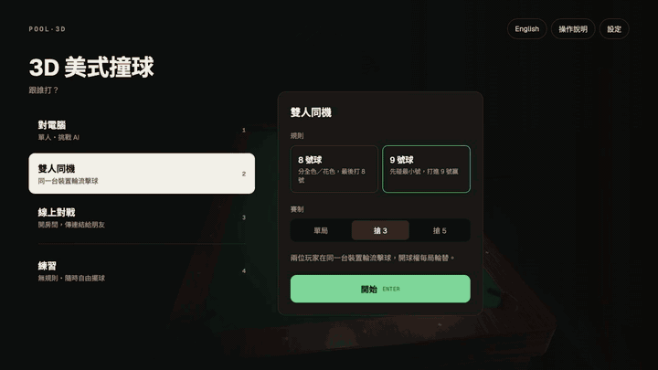

# 3D 美式撞球

[English](README.md) | 繁體中文

第一人稱視角的 3D 美式撞球，開瀏覽器就能玩，不用安裝。

**▶ 立即遊玩：https://yenchiachen.github.io/pool3d/**



▶ [完整高畫質影片（MP4，29 秒）](https://yenchiachen.github.io/pool3d/docs/demo-zh.mp4)

## 玩法

- **8 號球、9 號球**，含基本犯規、自由球與開球擺位
- **對電腦**（三種難度）、**雙人同機**、**線上對戰**、**練習**
- 加塞、高低桿、跳球、扎桿：打點與球桿仰角都會影響母球
- 9 號球會標出下一顆該打的球（N 鍵開關）
- 手機可玩：觸控瞄準、力道條，Android 支援全螢幕（iOS 請「加入主畫面」）
- 中文／英文介面，首頁右上角切換（也可以用 `?lang=en`）

## 操作

| 電腦 | |
|---|---|
| 滑鼠 | 瞄準 / 上下調整視角 |
| Shift + 滑鼠 | 微調瞄準 |
| 按住左鍵 | 蓄力，放開出桿 |
| 方向鍵 | 打點 |
| Q / E | 球桿仰角 |
| C | 打點與仰角歸零 |
| W A S D | 自由球時移動母球 |
| V / H / N / P | 俯視 / 輔助線 / 目標提示 / 重播 |
| Esc | 暫停 / 選單 |
| Tab | 全部按鍵 |

手機：單指拖曳瞄準、雙指縮放、右側力道條往下拉蓄力、左下白球設定打點。

## 線上對戰

開房間後把邀請連結傳給朋友，可以選搶 1、3 或 5 局。連線透過 [PeerJS](https://peerjs.com/) 點對點建立，沒有遊戲伺服器，雙方的瀏覽器直接互傳擊球資料。部分公司或校園網路會擋 P2P，這時可能連不上。

## 本機執行

```bash
git clone https://github.com/YenChiaChen/pool3d.git
cd pool3d
python3 -m http.server 8000
```

開 http://localhost:8000 就能玩。整個遊戲只有一個 `index.html`，three.js 與 PeerJS 從 CDN 載入，不用 build。

## 技術

- [three.js](https://threejs.org/) 負責繪圖，物理是自己寫的（1 ms 步進的球、庫邊、袋口碰撞）
- 球桌的布面與木紋用程式產生，不用圖檔
- 音效以 Web Audio 播放，載入失敗時改用即時合成的聲音

## 致謝

- 99% by Claude Code ^^ 1% is me paying the sub
- 擊球音效取自 [tailuge/billiards](https://github.com/tailuge/billiards)（GPL-3.0），執行時從 CDN 載入，不包含在本 repo 中

## License

[MIT](LICENSE)。上面提到的音效檔不在 MIT 授權範圍內，依其原本的 GPL-3.0 授權。
